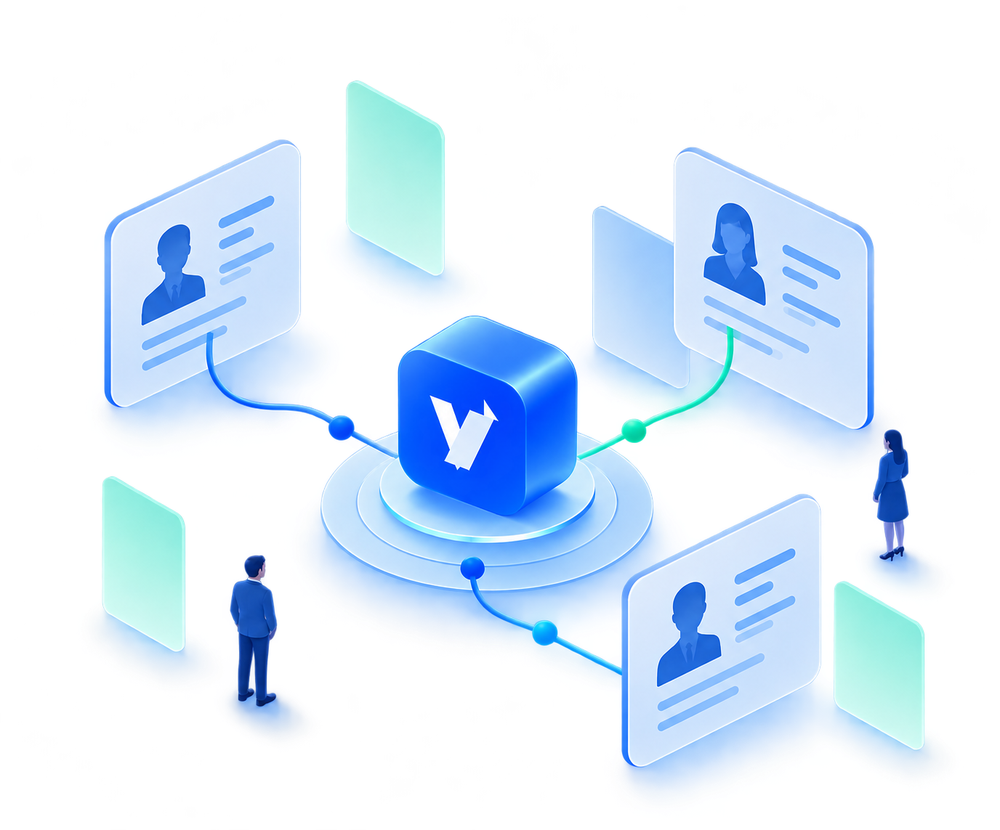

<p align="center">
  
</p>

<h1 align="center">VGO ATS</h1>

<p align="center"><strong>让人才与机会，在这里相遇。</strong></p>
<p align="center">连接简历、岗位与招聘流程的 AI 辅助招聘工作台。</p>

<p align="center">
  
  
  
  
  <a href="LICENSE"></a>
</p>

<p align="center">
  <a href="#项目介绍">🎯 项目介绍</a> ·
  <a href="#核心能力">✨ 核心能力</a> ·
  <a href="#本地运行">🚀 快速开始</a> ·
  <a href="#源码开发">🛠️ 源码开发</a> ·
  <a href="#常见问题">❓ 常见问题</a> ·
  <a href="#使用许可">📄 使用许可</a>
</p>

<p align="center">
  
</p>

> **仅限个人非商业使用。** 允许个人学习、研究、测试和自用；禁止商用及企业或其他组织的内部业务使用，即使不收费。完整条款见 [LICENSE](LICENSE)。

<a id="项目介绍"></a>

## 🎯 项目介绍

VGO ATS 由 **VGO 团队**维护，是一套围绕招聘过程构建的应聘者跟踪系统（Applicant Tracking System）。它将岗位管理、简历收件、结构化解析、AI 评估、招聘推进、面试安排和录用交付串联在同一个工作区，让每一次筛选都有依据、每一步进展都有记录。

项目提供 React 前端与 Java/Spring 后端，支持通过 Docker Compose 在本地运行。公开版本适合个人学习招聘领域建模、研究 AI 应用和体验完整的招聘工作流。

- 📌 **围绕事实协作**：岗位原文、简历版本、面评和实际入职分别保存，过程记录可以追溯。
- 🔎 **让判断有据可查**：AI 展示维度评价与原因，用户结合资料作出筛选、推进和录用决定。
- 🔒 **让数据留在可控的环境**：本地配置使用独立数据库、搜索服务和文件卷；外部模型与集成按需启用。

<a id="核心能力"></a>

## ✨ 核心能力

| 能力 | 可以做什么 |
| --- | --- |
| 💼 **岗位与公共 JD** | 管理岗位原文、招聘名额和周期；将可复用的公共 JD 应用为独立岗位，保留名称与原文，独立维护招聘配置。 |
| 📥 **简历收件与解析校验** | 批量上传 PDF、DOC、DOCX，关联岗位和来源渠道；查看解析、评分、重复、身份冲突及失败重试状态。AI 处理需先启用模型。 |
| 🧠 **AI 五维评估** | 从核心技能、岗位经历、相关年限、职责匹配、行业与项目五个维度提供专业评价；结合个人方案调整参考排序。 |
| 👥 **候选人与人才公海** | 按角色及对象授权查看候选人，支持关键词与条件筛选；公海简历选择岗位并完成本轮评分后，转入个人工作区。 |
| 🔄 **招募管道** | 跟进沟通、逐轮面试、客户推荐、录用和 Offer，记录实际操作者、时间及处理结果。 |
| 🗓️ **面试日历** | 汇总面试与沟通预约，查看详情、改期和取消，保持日程与招聘流程关联。 |
| 🤝 **录用交付** | 区分“入职中”和“已入职”，确认实际入职、更正时间或退回人才公海，保留历史记录。 |
| 📊 **招聘洞察与月报** | 查看漏斗、趋势、地区、渠道、名额和人员统计；上传两份 Excel，按固定规则生成可编辑的 Word 月报。 |

账号、部门、角色、来源渠道、个人筛选方案与后台任务也有对应管理入口，页面和操作范围由服务端权限控制。

<a id="一次完整的体验"></a>

### 🧭 一次完整的体验

1. 💼 **准备岗位**：创建 JD，或应用公共 JD 副本，维护名额、周期及招聘配置。
2. 📥 **接收简历**：选择岗位和来源，批量上传，在解析校验中处理失败、重复和身份问题。
3. 🧠 **评估与筛选**：启用 AI 后查看结构化资料、五维评估及个人参考排序，由用户决定是否推进。
4. 🔄 **推进招聘**：在招募管道记录沟通、面试、客户反馈、录用与 Offer，并通过面试日历安排预约。
5. 🤝 **完成交付**：确认实际入职，保留历史过程，并在招聘洞察中查看相应统计。

<a id="ai-如何参与"></a>

### 🧠 AI 如何参与

AI 负责提取资料和提供评价，筛选、推荐及录用由用户确认。项目保留原始评价、事实版本和历史结果，避免用最新资料替换过去判断的依据。

同一组冻结的 JD 事实、简历事实、提示词版本与结果结构版本下，可以复用已有专业评估；调整个人权重时，由 Java 对保存的五维原始分重新计算参考分。公开默认权重为五维各 **20%**，仅作为通用示例。

<a id="本地运行"></a>

## 🚀 本地运行

<a id="1-准备环境"></a>

### 🧰 1. 准备环境

安装并启动 **Docker Desktop**，或使用带 **Docker Compose v2** 的 Docker Engine。只体验本项目时，无需在宿主机安装 Java、Node.js、MySQL 或 Elasticsearch。

首次构建需要下载公开镜像、Maven 和 npm 依赖，请确保网络可用，并为 Docker 预留足够的内存和磁盘空间。

<a id="2-启动项目"></a>

### ▶️ 2. 启动项目

下载源码后，在包含 `compose.yaml` 的项目根目录执行：

```bash
docker compose up -d --build --wait
```

启动完成后，打开 **[http://localhost:5173](http://localhost:5173)**。

[compose.yaml](compose.yaml) 会构建并启动前端、后端、MySQL 和 Elasticsearch。宿主机只开放 `127.0.0.1:5173`；浏览器通过同一入口访问页面与 API。数据库、搜索及后端端口仅在容器网络中使用。

<a id="3-首次登录"></a>

### 🔑 3. 首次登录

| 项目 | 本地示例 |
| --- | --- |
| 👤 登录账号 | `admin`，或使用下面的工作邮箱 |
| 📧 工作邮箱 | `admin@example.org` |
| 🔑 初始密码 | `local-development-admin-password` |

这些是公开、可丢弃的本机开发值。**首次登录必须修改密码。** 已有管理员账号初始化完成后，重启不会覆盖其修改后的密码；其他账号由管理员创建或重置时生成随机一次性口令。

<a id="4-查看状态与停止"></a>

### ⏹️ 4. 查看状态与停止

```bash
# 查看容器和健康状态
docker compose ps

# 查看最近日志
docker compose logs --tail=100

# 停止应用，保留命名卷
docker compose down
```

数据库、搜索索引、文件和后端日志分别由 `mysql_data`、`elasticsearch_data`、`object_data`、`backend_logs` 命名卷持久化。停止并重新创建容器后，已有数据与改过的账号密码仍会保留。

<a id="默认体验包含什么"></a>

### 🔎 默认体验包含什么

本地使用 `dev,docker` Profile、独立的 `vgo_hr` 数据库和 **LOCAL 文件存储**，不需要配置 MinIO 或 OSS。AI、邮箱采集、企业微信及消息 Broker 在本地默认关闭；关闭状态会明确提示能力未启用，解析和评分不会返回伪造的成功结果。

因此，启动成功表示本地服务已就绪；要完整体验 JD／简历解析与专业评分，还需要先完成模型配置。建议首次体验使用合成岗位和简历。

<details>
<summary><strong>🗄️ 数据库初始化与升级说明</strong></summary>

默认启动由 Flyway 执行冻结的 `V0001` 和 37 份前向迁移，用于本公开发行的全新独立数据库。其他来源的存量库需要单独核对结构和迁移历史，不能直接套用本发行升级。

[最终态建库脚本](docs/sql/hr_ai_complete_schema.sql) 是另一条手工空库初始化路径，不能先执行它再叠加默认 Flyway 初始化。首次公开发行的岗位建议只包含 3 个合成通用示例。

Flyway 提示已执行迁移未解析时，先检查制品、运行 classpath 和迁移资源是否齐全；不得通过关闭校验、忽略缺失迁移、`repair` 或强行执行全量基线绕过。

</details>

<a id="配置与可选能力"></a>

## ⚙️ 配置与可选能力

| 能力 | 本地默认状态 | 启用前需要准备 |
| --- | --- | --- |
| 🧠 AI 解析与专业评分 | 关闭 | 模型供应商、模型与访问配置，`hr.ai.parsing.enabled` 开关，以及独立的 32 字节 Base64 归档密钥。 |
| 🖼️ 多模态辅助解析 | 关闭 | 支持视觉输入的模型、对应开关和文档处理预算。 |
| 📬 邮箱收件 | 关闭 | 邮箱连接与授权信息、识别及分配规则；首次启用建立游标基线，后续处理新邮件。 |
| 🏢 企业微信 | 目录读取、组织同步及新会议创建关闭 | 企业应用、组织映射、凭据和相应能力开关。 |
| 📨 RabbitMQ | 本地发布与消费关闭 | Broker、凭据、TLS 及发布／消费开关；生产 Profile 按自身配置启用。 |
| 📁 附件存储 | 本地文件 | 本地体验无需额外配置；其他存储适配通过部署配置维护，工作区不提供云存储管理页面。 |

配置入口：

- [公共运行配置](bootstrap/src/main/resources/application.yml)：服务端口、任务、文档预算及通用设置。
- [本机开发配置](bootstrap/src/main/resources/application-dev.yml)：本地数据库、搜索与文件存储。
- [容器覆盖配置](bootstrap/src/main/resources/application-docker.yml)：Compose 容器内的服务地址。
- [生产配置](bootstrap/src/main/resources/application-prod.yml)与[秘密配置示例](deploy/application-prod-secrets.example.yml)：独立部署时的覆盖入口，示例占位值须由部署方替换。

真实密钥、简历和业务数据应保存在受控环境，不提交到源码、Issue、截图或发布包。启用外部模型前，先确认发送数据的授权和处理范围。开发扫描器仅适合合成文件体验；公开上传入口需要配置健康的恶意文件扫描服务。

<a id="技术与架构"></a>

## 🧱 技术与架构

| 层次 | 技术与职责 |
| --- | --- |
| 💻 前端 | React 19、TypeScript 5、Vite 8、Ant Design 6、TanStack Query |
| ⚙️ 后端 | Java 21、Spring Boot 4.1、Spring AI 2、MyBatis-Plus |
| 🗄️ 数据与搜索 | MySQL 8、Elasticsearch 8、Flyway |
| 🐳 运行方式 | 模块化单体、Docker Compose、Nginx 同源代理 |
| ✅ 质量检查 | JUnit、架构与契约测试、Vitest、Playwright |

后端采用**模块化单体**，`bootstrap` 是唯一启动入口。业务模块是编译期边界，随同一个应用运行；解析、评分、搜索和任务处理分别保留自己的状态、资源限制与恢复逻辑。前端位于 `ui/`，通过同源 `/api/v1` 与后端协作。

```text
VGO_ATS/
├── bootstrap/       # 启动、配置、运行资源与数据库迁移
├── identity/        # 账号、组织、角色及对象授权
├── talent/          # 简历收件、候选人、事实与版本
├── recruiting/      # JD、招聘流程、面试及客户推荐
├── intelligence/    # AI 评估、个人排序与搜索
├── integration/     # 模型、文档、存储及外部系统适配
├── reporting/       # 指标、月报、异步任务与恢复
├── common/          # 跨模块公共能力
├── contract-test/   # 架构、接口及 SQL 等契约检查
├── ui/              # React 前端、产品与视觉规范
├── docs/            # SQL 脚本与架构图
├── deploy/          # 部署脚本、代理及配置模板
└── compose.yaml     # 本机完整环境
```

Java 命名空间与 Maven 制品标识沿用现有工程，以保持调用及迁移兼容；对外产品名称与视觉标识为 VGO ATS。

<a id="源码开发"></a>

## 🛠️ 源码开发

<a id="开发环境"></a>

### 💻 开发环境

- **后端**：JDK 21；仓库提供 Maven Wrapper，无需另装 Maven。
- **前端**：Node.js 22.12.0 或更高版本，使用仓库锁文件安装依赖。
- **本机调试**：自行准备可连接的独立 MySQL 和 Elasticsearch，地址与开发配置保持一致。Compose 中的数据库和搜索没有映射宿主端口。

前端开发，在仓库根目录执行：

```bash
npm --prefix ui ci
npm --prefix ui run dev
```

Vite 默认使用 `5173` 端口，并把 `/api` 代理到 `http://localhost:8080`。启动前确认本机后端已可用，并避免与 Compose 的前端入口占用同一端口。前端命令与目录说明见 [ui/README.md](ui/README.md)。

后端可使用 IntelliJ IDEA 的[共享运行配置](.run/HrPlatformApplication.run.xml) `HrPlatformApplication（含数据库迁移资源）`。它先执行 Make，再执行 `-pl bootstrap -am process-resources`，生成并复制 `bootstrap/target/generated-resources/db/migration` 等资源；仅执行 Make 的自动配置不能替代这一步。

宿主机 Java 调试使用以下 JVM 参数，让本机数据库与搜索绕过该 Java 进程的代理：

```text
-DsocksNonProxyHosts=localhost|127.*|[::1]
-Dhttp.nonProxyHosts=localhost|127.*|[::1]
```

本机管理员的首次初始化可参照 `compose.yaml` 中公开的 `HR_BOOTSTRAP_ADMIN_*` 设置；这些示例只供独立本地环境使用。

<a id="验证命令"></a>

### ✅ 验证命令

```bash
# 后端测试与质量检查（项目根目录）
JAVA_TOOL_OPTIONS=-Djava.awt.headless=true sh mvnw -B -ntp clean verify

# 前端：lint、类型检查、单元测试、生产构建
npm --prefix ui run quality

# 浏览器回归
npm --prefix ui run test:e2e
```

首次执行浏览器回归时，在 `ui/` 下运行 `npx playwright install chromium` 安装浏览器；也可用 `PLAYWRIGHT_CHANNEL=chrome` 选择已安装的 Chrome。真实 MySQL、搜索、消息及模型集成测试需要显式配置独立测试环境，不能用模拟测试结果替代真实服务验收。

<a id="常见问题"></a>

## ❓ 常见问题

<details>
<summary><strong>🧠 启动后为什么不能解析或评分？</strong></summary>

本地默认关闭外部模型调用。先核对模型、访问配置、能力开关和归档密钥，再检查后台任务状态。只填写一个 API Key 并不等于所有模型能力已经启用。

</details>

<details>
<summary><strong>🔑 为什么默认密码不能登录，或者重启后没有恢复？</strong></summary>

已有数据库会保留改过的密码，初始化不会覆盖已有管理员。默认值仅用于全新本地环境的首次登录；其他账号使用管理员创建或重置时生成的一次性口令。

</details>

<details>
<summary><strong>🌐 为什么宿主机访问不到 8080、3306 或 9200？</strong></summary>

根 Compose 只把前端入口 `127.0.0.1:5173` 映射到宿主机。后端、数据库和搜索通过容器网络通信；本机浏览器使用统一前端地址即可。宿主源码调试需要另行准备可连接的中间件。

</details>

<details>
<summary><strong>💾 停止容器会丢失简历和账号吗？</strong></summary>

本文使用的 `docker compose down` 保留命名卷。数据、文件和已修改的账号密码仍在卷中；清除数据属于独立操作，应先确认目标与备份。

</details>

<details>
<summary><strong>⚖️ 可以免费给公司部署，或做成收费服务吗？</strong></summary>

本项目仅允许个人非商业使用。免费部署、组织内部使用或以个人名义操作，都不能豁免商业及组织业务限制。超出范围的用途须事先取得 VGO 团队明确书面授权，完整条款以 [LICENSE](LICENSE) 为准。

</details>

<a id="反馈与参与"></a>

## 🤝 反馈与参与

欢迎通过当前仓库的 Issues 反馈可复现问题，或提交改进建议。请说明操作步骤、预期与实际结果、运行方式和相关版本，并对日志、截图中的个人资料与凭据脱敏。

提交改动时，请说明修改原因、影响范围和验证结果，遵守仓库 [AGENTS.md](AGENTS.md) 与当前许可证。代码、文档、样本和素材应来自你有权提交的内容；测试使用合成数据。

工程入口：[前端说明](ui/README.md) · [产品上下文](ui/PRODUCT.md) · [视觉规范](ui/DESIGN.md) · [后端开发规范](.agents/skills/hr-ai-backend-development/SKILL.md) · [后端验证规范](.agents/skills/hr-ai-change-verification/SKILL.md)。

<a id="使用许可"></a>

## 📄 使用许可

Copyright (c) 2026 **VGO Team（VGO 团队）**。

本项目采用 **[VGO 个人非商业使用许可证 1.0](LICENSE)**：

- 允许个人非商业的学习、研究、实验、测试、自用，以及遵守相同限制的分享和修改。
- 禁止商用，包括收费产品、SaaS、托管、代部署、外包交付及商业产品集成。
- 禁止企业或其他组织用于内部招聘、人事管理等业务，即使不收费。
- 超出许可范围的用途，须事先取得 VGO 团队单独、明确的书面授权。

这是公开源码的非商业许可项目，不属于标准开源许可项目。第三方依赖、字体、素材和数据保留各自的版权与许可证，具体条款以许可证原文和第三方声明为准。

---
